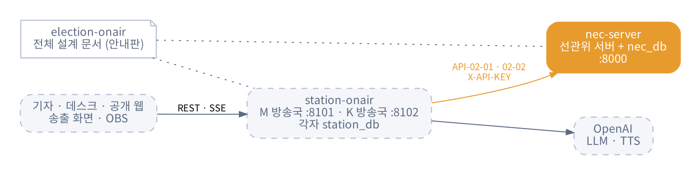
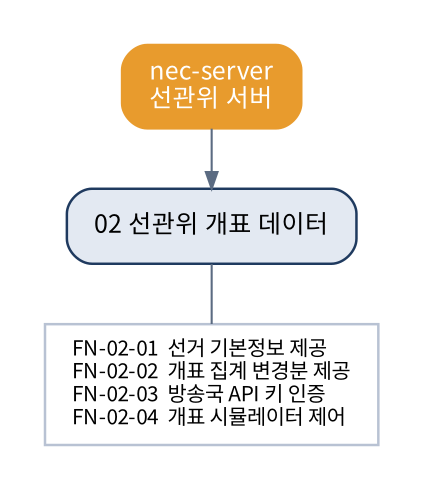
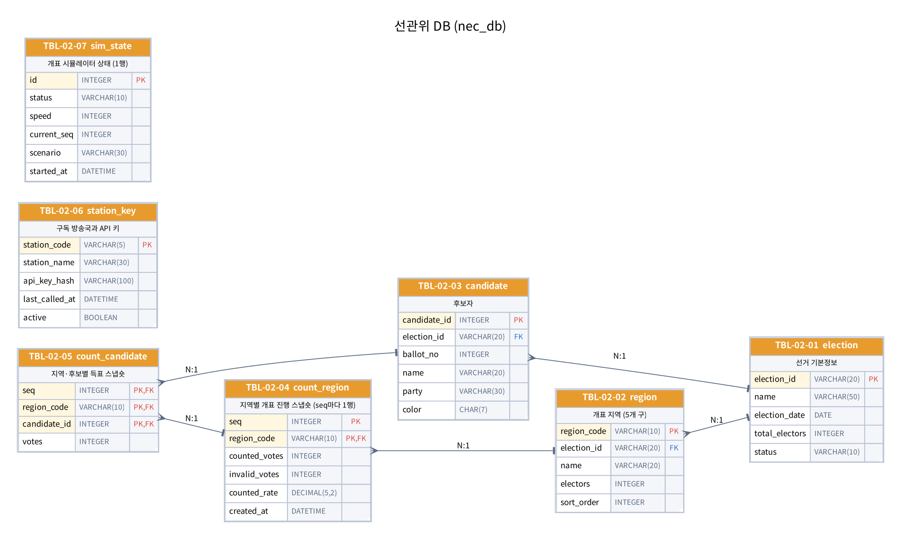
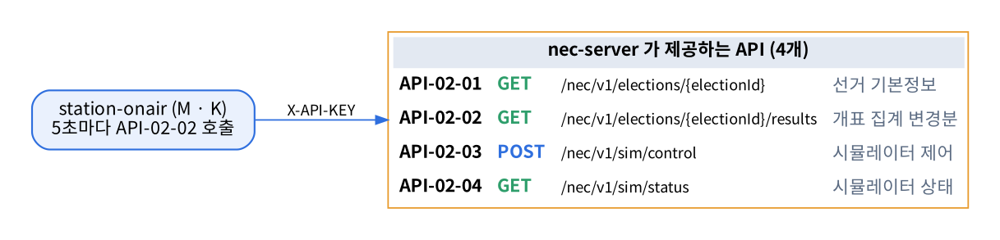
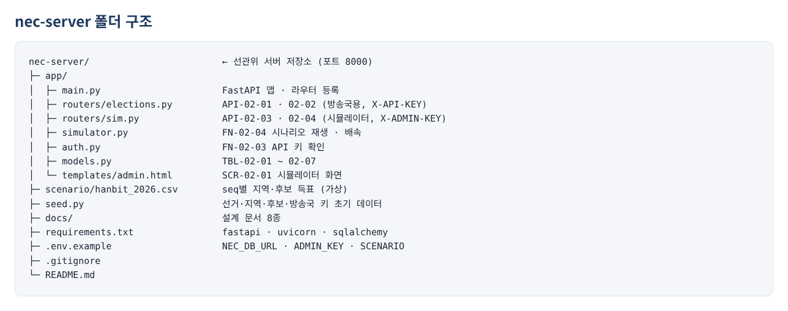

# 🗳️ nec-server — 선관위 서버

> AI 실시간 개표방송 시스템 · P1 팀 프로젝트

선거 원천 데이터(선거·지역·후보)와 개표 집계를 보관하고, 등록된 방송국(M·K)에게 API로 제공하는 서버입니다. 리허설과 본방송을 위해 개표 진행을 재현하는 시뮬레이터를 포함합니다.

<p align="center"></p>
<p align="center"><sub>전체 시스템에서 이 저장소의 위치</sub></p>

| 항목 | 내용 |
|---|---|
| 포트 | 8000 |
| 맡는 영역 | 02 선관위 개표 데이터 |
| 연결 저장소 | [station-onair](https://github.com/journal-izm/station-onair) |
| 전체 설계 | [election-onair](https://github.com/journal-izm/election-onair) |
| 설계 문서 폴더 | [Google Drive](https://drive.google.com/drive/folders/1Izs8LAkGqGRGMGK07rxIR9qtcB-rEDFs) |
| 규모 | 요구 7 · 기능 4 · 화면 1 · API 4 · 테이블 7 |

## 🤝 API 계약 (두 저장소를 잇는 약속)

| API | 경로 | 제공 | 호출 |
|---|---|---|---|
| API-02-01 | `GET /nec/v1/elections/{electionId}` | nec-server | station-onair (M·K) |
| API-02-02 | `GET /nec/v1/elections/{electionId}/results?since_seq={n}` | nec-server | station-onair (M·K) |

이 형식을 바꾸는 PR은 상대 저장소 담당자의 확인을 받습니다.

## 🚀 실행

```bash
python -m venv .venv && source .venv/bin/activate   # Windows: .venv\Scripts\activate
pip install -r requirements.txt
cp .env.example .env      # ADMIN_KEY 채우기
python seed.py            # 방송국 API 키 2개가 화면에 한 번 나옴 → station-onair .env.m/.env.k의 NEC_API_KEY
uvicorn app.main:app --port 8000     # 관리 화면 :8000/admin · API 문서 :8000/docs
```

## 📦 구현 현황 (1단계 완료)

| 영역 | 파일 | 설계 번호 |
|---|---|---|
| 시나리오 | `scenario/hanbit_2026.csv` · `tools/make_scenario.py` · `app/scenario.py` | FN-02-04, NFR-04 |
| 시뮬레이터 | `app/simulator.py` (시작·일시정지·1/2/5배속·초기화·시연 모드 자동 반복) | FN-02-04, REQ-02-05 |
| 방송국 API | `app/routers/elections.py` | API-02-01 · 02 |
| 관리 API·화면 | `app/routers/sim.py` · `app/templates/admin.html` | API-02-03 · 04, SCR-02-01 |
| 인증 | `app/auth.py` (키는 해시로만 저장) | FN-02-03, NFR-02 |
| DB | `app/models.py` | TBL-02-01 ~ 07 |

시나리오 줄거리: 초반 기호 2 류해온 우세 → 개표율 약 72%(LIVE 7분 무렵) 기호 1 윤별하 역전 → 9분 무렵 당선 유력·확실·확정 (1배속, 전체 10분).

## 🛠 실행할 때 알아 둘 점

| 상황 | 해결 |
|---|---|
| 방송국 서버가 Ctrl+C로 안 꺼짐 | 열린 화면(개표 웹·수신 모니터·송출 화면)의 실시간 연결(SSE)이 끝나길 기다리는 중. 8101·8102 브라우저 탭을 닫거나 Ctrl+C를 한 번 더. 켤 때 --timeout-graceful-shutdown 2를 붙이면 2초 뒤 꺼짐 |
| 서버 켜는 순서 | 선관위(8000) → M(8101) → K(8102). 수신 모니터(/monitor)가 '● 정상'인지 확인한 뒤 선관위 ▶ 시작 |
| 초기 데이터(seed) | 선관위: python seed.py / 방송국: python seed.py --env .env.m (PowerShell에서는 ENV_FILE=… 앞붙이기가 안 됨). 두 서버 모두 처음 켤 때 데이터가 없으면 자동 실행 |
| 방송국 키 | 선관위 .env에 STATION_KEY_M · STATION_KEY_K를 직접 정해 두고, 방송국 .env.m · .env.k의 NEC_API_KEY에 같은 값. 수신 모니터에 '응답 401'이면 키가 다른 것 |
| DB 파일 칸 | STATION_DB_URL은 비워 두거나 파일 이름만(station_m.db / station_k.db). M·K가 같은 파일을 쓰면 데이터가 섞임 |
| 다른 방송국 링크 | OTHER_STATION_URL — M은 http://localhost:8102, K는 http://localhost:8101 |

방송국 실행 명령: `uvicorn app.main:app --port 8101 --env-file .env.m --timeout-graceful-shutdown 2`

## 🧪 테스트

```bash
python -m pytest -q          # 1차 확인 테스트케이스 중 자동 항목 (test_tc_… 이름 = TC 번호)
```

단계별 수동 테스트(화면·소리·장애 상황)와 결과 기록표: **[TEST_GUIDE](https://github.com/journal-izm/election-onair/blob/main/docs/TEST_GUIDE.md)** · 방송국 DB 확인 도구: `tools/check.py` (station-onair)

## 📌 번호 체계

가운데 두 자리(영역 코드)가 같으면 같은 기능 묶음입니다. 번호는 전체 설계(election-onair)와 같습니다.

<p align="center"></p>
<p align="center"><sub>이 저장소의 번호 범위</sub></p>

## 📚 설계 문서 8종

<details>
<summary><b>01 · 기획서 — 역할·범위·API 계약·일정</b></summary>

📄 원본: [Google Docs](https://docs.google.com/document/d/1L47u2tiqSNGEITmLd3QAB1aKOfRd63OPQA-Fu0Jb9do/edit) · [Word 파일](docs/01_기획서_nec-server.docx)

### 범위
| 포함 | 제외 (station-onair 담당) |
|---|---|
| 선거·지역·후보 기본정보 API | 기사 생성·송고·승인 |
| 개표 집계 변경분 API (since_seq) | 실시간 개표 웹·방송 화면 |
| 방송국 API 키 인증 | 기자·데스크 계정 |
| 개표 시뮬레이터 + 관리 화면 | TTS·영상·송출 |

### 개표 시나리오
가상 「2026 한빛시장 모의선거」 — 5개 구, 후보 3명.
- CSV 한 줄 = seq 하나의 지역·후보별 누적 득표
- 1배속에서 0→100%가 약 11분 (방송 LIVE 구간 길이)
- 당선 확정이 시작 후 약 10분 무렵 나오도록 설계
- 리허설 5배속, 본방송 1배속, 초기화로 반복 재현 (NFR-04)

#### 지역·후보
| 코드 | 이름 |
|---|---|
| STAR | 별빛구 |
| DEEP | 심해구 |
| DUNE | 사막구 |
| NEBULA | 성운구 |
| ORBIT | 궤도구 |

| 기호 | 후보 (정당) | 콘셉트 · 슬로건 | 이력 | 공약 | 색 |
|---|---|---|---|---|---|
| 1 | 윤별하 (은하공화연합) | 은하 함대 조종사 · “흩어진 별들을 하나의 항로로” | 은하 함대 정찰기 조종사 출신 / 소행성대 구조 작전 지휘 / 우주정거장 '은하1호' 사령관 / 은하공화연합 대표 | 구와 구를 5분 안에 잇는 '초공간 셔틀' 노선 / 구마다 함대식 재난 구조대 / 청소년 조종사 학교 설립 | #FF2BD6 |
| 2 | 류해온 (심해행성연맹) | 바다 행성의 수호자 · “가장 깊은 바다에서 온 약속” | 바다 행성 '아쿠아리스' 출신 / 심해 도시 방어막 설계 기술자 / 해저 잠수 함대 '해온호' 함장 / 심해행성연맹 대표 | 바닷속 쓰레기 수거 로봇 함대 / 해저 연구 도시 유치로 일자리 / 모든 행성 어린이 바다교실 무료 | #00E5FF |
| 3 | 오로라 (무소속) | 사막 행성의 외계 통역사 · “모든 종족의 목소리에 답하겠습니다” | 사막 행성의 외계 언어 통역사 / 정체불명 신호 '로라 신호' 해독 / 보조 로봇 '피코'와 우주 교역소 운영 / 첫 출마 | 외계 주민도 쓰는 '만능 번역 민원 창구' / 로봇이 24시간 답하는 구청 민원 / 우주 교역 시장 개설 | #A6FF00 |

> 후보·정당·지역은 모두 가상입니다. 우주 SF 분위기로 만들었지만 실존 영화·작품의 인물·행성 이름, 대사, 로고, 음악은 쓰지 않습니다. 색은 네온색이라 어두운 배경(방송 화면·차트)에서 쓰고, 흰 배경 글자에는 진한색을 씁니다.

### 일정
<p align="center"></p>
<p align="center"><sub>P1 일정</sub></p>

<details>
<summary><b>✅ 테스트케이스 — 1차 확인 (시나리오 테스트 3개)</b></summary>

20분 방송을 처음부터 끝까지 돌려 보며 큰 흐름이 맞는지 확인합니다. 단계: 1 선관위 서버 · 2 방송국 수신·웹 · 3 기사 흐름 · 4 송출 · 5 마무리

| 번호 | 단계 | 확인할 것 | 절차 | 기대 결과 | 근거 | 방식 |
|---|---|---|---|---|---|---|
| TC-SC-01 | 4 | 20분 방송 한 바퀴 (5배속 리허설) | 모두 초기화 → 데스크가 송출 시작 → LIVE가 시작될 때(방송 4:30) 시뮬레이터 5배속 시작. 기사가 나오면 기자 송고·데스크 승인을 계속한다. | 카운트다운 → 오프닝 → 후보 소개 3개 → LIVE → 당선 확정 기사 → 인터뷰·이력·공약 → 최종 정리 → 마무리 순서로 멈춤 없이 끝난다. 5배속은 개표만 빨라지고 영상 구간은 실제 길이라 전체 약 12분. | REQ-07-01, REQ-07-04, NFR-04 | 수동 |
| TC-SC-02 | 2 | 같은 결과 다시 재현 | 리허설을 2번 한다. 두 번 모두 같은 시점에 개표율·1위·이벤트를 적어 둔다. | 1위 변동·당선 확정이 두 번 모두 같은 시점, 같은 후보로 나온다. | NFR-04, REQ-02-04 | 수동 |
| TC-SC-06 | 5 | 클라우드 시연 모드 | DEMO_MODE=1로 배포한 주소에 처음 접속한다. | 1분 안에 깨어나고, 아무도 누르지 않아도 개표가 시작돼 끝나면 처음부터 반복한다. | REQ-02-05 | 수동 |


</details>


</details>

<details>
<summary><b>02 · 요구사항정의서 — 요구 7개와 추적표</b></summary>

📄 원본: [Google Docs](https://docs.google.com/document/d/1IX61rsmplFbQUfgAEYyJDZL9Tr1paCopO3T9aAOLil8/edit) · [Word 파일](docs/02_요구사항정의서_nec-server.docx)

### 영역 02 · 선관위 개표 데이터
| 요구 ID | 요구사항명 | 내용 | 우선순위 | 관련 기능 |
|---|---|---|---|---|
| REQ-02-01 | 선거 기본정보 제공 | 선관위 서버는 선거·지역(5개 구)·후보(3명) 기본정보를 API로 제공한다. | 필수 | FN-02-01 |
| REQ-02-02 | 개표 집계 변경분 제공 | 선관위 서버는 지역·후보별 득표와 개표율을 갱신하고, 순번(seq) 이후의 변경분만 내려준다. | 필수 | FN-02-02 |
| REQ-02-03 | 방송국 인증 | 선관위 API는 등록된 방송국(M·K)이 발급받은 API 키로만 호출할 수 있다. | 필수 | FN-02-03 |
| REQ-02-04 | 개표 시뮬레이터 | 리허설·방송을 위해 개표 진행을 시작·일시정지·배속·초기화할 수 있다. | 필수 | FN-02-04 |
| REQ-02-05 | 클라우드 시연 모드 | 클라우드 배포본은 서버가 켜질 때 초기 데이터를 넣고 개표 시나리오를 자동으로 반복 재생한다. | 권장 | FN-02-04 |

### 비기능 요구사항
| 요구 ID | 구분 | 요구사항명 | 내용 | 관련 기능 |
|---|---|---|---|---|
| NFR-02 | 보안 | 비밀 정보 보호 | 비밀번호는 해시로 저장, API 키·OpenAI 키는 .env에 두고 Git에 올리지 않는다. | FN-02-03 |
| NFR-04 | 운영 | 반복 리허설 | 시뮬레이터 초기화로 같은 개표 시나리오를 몇 번이고 다시 재현할 수 있다. | FN-02-04 |

### 추적표
| 요구 ID | 기능 | 화면 | API | 테이블 |
|---|---|---|---|---|
| REQ-02-01 | FN-02-01 | — | API-02-01 | TBL-02-01, TBL-02-02, TBL-02-03 |
| REQ-02-02 | FN-02-02 | — | API-02-02 | TBL-02-04, TBL-02-05 |
| REQ-02-03 | FN-02-03 | — | API-02-01, API-02-02 | TBL-02-06 |
| REQ-02-04 | FN-02-04 | SCR-02-01 | API-02-03, API-02-04 | TBL-02-04, TBL-02-05, TBL-02-07 |
| REQ-02-05 | FN-02-04 | SCR-02-01 | API-02-03, API-02-04 | TBL-02-04, TBL-02-05, TBL-02-07 |
| NFR-02 | FN-02-03 | — | API-02-01, API-02-02 | TBL-02-06 |
| NFR-04 | FN-02-04 | SCR-02-01 | API-02-03, API-02-04 | TBL-02-04, TBL-02-05, TBL-02-07 |

<details>
<summary><b>✅ 테스트케이스 — 1차 확인 (인수 테스트 1개)</b></summary>

요구사항(특히 권한·보안·속도 같은 비기능)을 지켰는지 확인합니다. 아래 추적표로 모든 요구사항이 한 번 이상 확인되는지 봅니다. 단계: 1 선관위 서버 · 2 방송국 수신·웹 · 3 기사 흐름 · 4 송출 · 5 마무리

| 번호 | 단계 | 확인할 것 | 절차 | 기대 결과 | 근거 | 방식 |
|---|---|---|---|---|---|---|
| TC-RQ-05 | 1 | 비밀 정보 보호 | users 표의 비밀번호 칸과 서버 로그를 살펴본다. | 비밀번호는 해시로만 저장되고, API 키·OpenAI 키가 로그에 찍히지 않는다. | NFR-02 | 자동 |

**요구사항 → 확인 테스트**

| 요구사항 | 이름 | 확인하는 테스트 |
|---|---|---|
| REQ-02-01 | 선거 기본정보 제공 | TC-API-01, TC-API-02 |
| REQ-02-02 | 개표 집계 변경분 제공 | TC-API-01, TC-API-03, TC-FN-01 |
| REQ-02-03 | 방송국 인증 | TC-API-01, TC-API-02, TC-API-03 |
| REQ-02-04 | 개표 시뮬레이터 | TC-API-04, TC-SC-02, TC-UI-02 |
| REQ-02-05 | 클라우드 시연 모드 | TC-API-04, TC-ENV-05, TC-SC-06, TC-UI-02 |
| NFR-02 | 비밀 정보 보호 | TC-API-01, TC-API-02, TC-API-03, TC-ENV-01, TC-ENV-02, TC-ENV-03, TC-RQ-05 |
| NFR-04 | 반복 리허설 | TC-API-04, TC-SC-01, TC-SC-02, TC-UI-02 |


</details>


</details>

<details>
<summary><b>03 · 기능정의서 — 기능 4개·상태·업무 규칙</b></summary>

📄 원본: [Google Docs](https://docs.google.com/document/d/1mGIr3z_ha30krUNZQG2j4hIfDvFXanbYWvzuSS38dvc/edit) · [Word 파일](docs/03_기능정의서_nec-server.docx)

<p align="center"></p>
<p align="center"><sub>기능 구조도</sub></p>

### 영역 02 · 선관위 개표 데이터
| 기능 ID | 기능명 | 설명 | 요구 | 화면 | API | 테이블 |
|---|---|---|---|---|---|---|
| FN-02-01 | 선거 기본정보 제공 | 선거·지역·후보 정보를 방송국에 제공 | REQ-02-01 | — | API-02-01 | TBL-02-01 TBL-02-02 TBL-02-03 |
| FN-02-02 | 개표 집계 변경분 제공 | since_seq 이후 바뀐 지역·후보 집계만 응답 | REQ-02-02 | — | API-02-02 | TBL-02-04 TBL-02-05 |
| FN-02-03 | 방송국 API 키 인증 | X-API-KEY 헤더를 등록된 키와 대조 | REQ-02-03 NFR-02 | — | API-02-01 API-02-02 | TBL-02-06 |
| FN-02-04 | 개표 시뮬레이터 제어 | 시나리오에 따라 집계를 늘림. 시작·일시정지·배속·초기화. 시연 모드(DEMO_MODE)에서는 자동 시작·반복 | REQ-02-04 REQ-02-05 NFR-04 | SCR-02-01 | API-02-03 API-02-04 | TBL-02-07 TBL-02-04 TBL-02-05 |

### 시뮬레이터 상태
<p align="center"></p>
<p align="center"><sub>시뮬레이터 상태 전이</sub></p>

| 규칙 | 내용 |
|---|---|
| NBR-01 | 발행한 seq의 집계는 고치지 않는다 |
| NBR-02 | 득표는 누적값, 이전 seq보다 줄지 않는다 |
| NBR-03 | 비활성 방송국 키는 401 |
| NBR-04 | 호출 시 last_called_at 갱신 |
| NBR-05 | reset은 스냅숏 삭제 + seq 0 |

<details>
<summary><b>✅ 테스트케이스 — 1차 확인 (기능 테스트 1개)</b></summary>

기능과 업무 규칙(BR)이 계산·상태 변화를 맞게 하는지 확인합니다. 대부분 pytest로 자동화합니다. 단계: 1 선관위 서버 · 2 방송국 수신·웹 · 3 기사 흐름 · 4 송출 · 5 마무리

| 번호 | 단계 | 확인할 것 | 절차 | 기대 결과 | 근거 | 방식 |
|---|---|---|---|---|---|---|
| TC-FN-01 | 1 | 변경분만 내려주기 | seq 10까지 쌓인 상태에서 since_seq=10, 이어서 since_seq=최신 값으로 요청한다. | 첫 요청은 seq 11 이상만, 두 번째 요청은 빈 목록을 받는다. | FN-02-02, REQ-02-02 | 자동 |


</details>


</details>

<details>
<summary><b>04 · 화면설계서 — 화면 1개</b></summary>

📄 원본: [Google Docs](https://docs.google.com/document/d/1aXYxPmPbQPW5DlfUGIPjQ_SLAV19PIywqqmhVYVHTSY/edit) · [Word 파일](docs/04_화면설계서_nec-server.docx)

| 화면 ID | 화면명 | 사용자 | URL |
|---|---|---|---|
| SCR-02-01 | 선관위 개표 시뮬레이터 | 선관위 운영자(관리자 키) | nec:/admin |

<details>
<summary><b>SCR-02-01 선관위 개표 시뮬레이터 <sub>(선관위 운영자(관리자 키))</sub></b></summary>

개표 진행을 재현하는 선관위 쪽 관리 화면. 계정이 아니라 관리자 키로 접근

- 관련 기능: FN-02-04
- 사용 API: API-02-03, API-02-04
- 사용 테이블: TBL-02-04, TBL-02-05, TBL-02-07

<p align="center"></p>
<p align="center"><sub>SCR-02-01 선관위 개표 시뮬레이터</sub></p>

| 번호 | 요소 | 설명 |
|---|---|---|
| 1 | 진행 상태 | 대기 / 개표 중 / 일시정지 / 종료 |
| 2 | 제어 버튼 | 시작·일시정지·초기화 |
| 3 | 배속 | 1×·2×·5× (리허설은 5×, 본방송은 1×) |
| 4 | 현재 seq·개표율 | 전체 개표율과 마지막 순번 |
| 5 | 구독 방송국 | M·K 방송국의 마지막 호출 시각 |


</details>

<details>
<summary><b>✅ 테스트케이스 — 1차 확인 (화면 테스트 1개)</b></summary>

화면 요소가 설계대로 보이고 움직이는지 사람이 직접 눌러 보며 확인합니다. 단계: 1 선관위 서버 · 2 방송국 수신·웹 · 3 기사 흐름 · 4 송출 · 5 마무리

| 번호 | 단계 | 확인할 것 | 절차 | 기대 결과 | 근거 | 방식 |
|---|---|---|---|---|---|---|
| TC-UI-02 | 1 | 개표 시뮬레이터 | 시작 · 일시정지 · 5배속 · 초기화 버튼을 차례로 누른다. | 상태·배속·seq 표시가 바로 바뀌고, 초기화하면 개표율 0%, seq 0으로 돌아간다. | SCR-02-01, REQ-02-04 | 수동 |


</details>


</details>

<details>
<summary><b>05 · DB설계서 — 테이블 7개</b></summary>

📄 원본: [Google Docs](https://docs.google.com/document/d/13dc3b-mvjBvF_wD-lN2gzxd-orJIHH1waHR83iQLrsQ/edit) · [Word 파일](docs/05_DB설계서_nec-server.docx)

<p align="center"></p>
<p align="center"><sub>nec_db ERD</sub></p>

| 테이블 ID | 테이블명 | 설명 | 사용 기능 |
|---|---|---|---|
| TBL-02-01 | `election` | 선거 기본정보 | FN-02-01 |
| TBL-02-02 | `region` | 개표 지역 (5개 구) | FN-02-01 |
| TBL-02-03 | `candidate` | 후보자 | FN-02-01 |
| TBL-02-04 | `count_region` | 지역별 개표 진행 스냅숏 (seq마다 1행) | FN-02-02 FN-02-04 |
| TBL-02-05 | `count_candidate` | 지역·후보별 득표 스냅숏 | FN-02-02 FN-02-04 |
| TBL-02-06 | `station_key` | 구독 방송국과 API 키 | FN-02-03 |
| TBL-02-07 | `sim_state` | 개표 시뮬레이터 상태 (1행) | FN-02-04 |

<details>
<summary><b>TBL-02-01 <code>election</code> — 선거 기본정보</b></summary>

| 컬럼 | 타입 | 키 | NULL | 설명 |
|---|---|---|---|---|
| `election_id` | VARCHAR(20) | PK | N | 예: HANBIT-2026 |
| `name` | VARCHAR(50) |  | N | 선거명 |
| `election_date` | DATE |  | N | 선거일 |
| `total_electors` | INTEGER |  | N | 전체 선거인 수 |
| `status` | VARCHAR(10) |  | N | READY / COUNTING / CLOSED |


</details>

<details>
<summary><b>TBL-02-02 <code>region</code> — 개표 지역 (5개 구)</b></summary>

| 컬럼 | 타입 | 키 | NULL | 설명 |
|---|---|---|---|---|
| `region_code` | VARCHAR(10) | PK | N | STAR / DEEP … |
| `election_id` | VARCHAR(20) | FK | N | → election |
| `name` | VARCHAR(20) |  | N | 별빛구 등 |
| `electors` | INTEGER |  | N | 지역 선거인 수 |
| `sort_order` | INTEGER |  | N | 표시 순서 |


</details>

<details>
<summary><b>TBL-02-03 <code>candidate</code> — 후보자</b></summary>

| 컬럼 | 타입 | 키 | NULL | 설명 |
|---|---|---|---|---|
| `candidate_id` | INTEGER | PK | N | 후보 번호 |
| `election_id` | VARCHAR(20) | FK | N | → election |
| `ballot_no` | INTEGER |  | N | 기호 |
| `name` | VARCHAR(20) |  | N | 이름 |
| `party` | VARCHAR(30) |  | Y | 정당 |
| `color` | CHAR(7) |  | N | 차트 색 (#RRGGBB) |


</details>

<details>
<summary><b>TBL-02-04 <code>count_region</code> — 지역별 개표 진행 스냅숏 (seq마다 1행)</b></summary>

| 컬럼 | 타입 | 키 | NULL | 설명 |
|---|---|---|---|---|
| `seq` | INTEGER | PK | N | 갱신 순번 (전체 공통 증가) |
| `region_code` | VARCHAR(10) | PK,FK | N | → region |
| `counted_votes` | INTEGER |  | N | 개표된 투표수 |
| `invalid_votes` | INTEGER |  | N | 무효표 |
| `counted_rate` | DECIMAL(5,2) |  | N | 지역 개표율(%) |
| `created_at` | DATETIME |  | N | 집계 시각 |


</details>

<details>
<summary><b>TBL-02-05 <code>count_candidate</code> — 지역·후보별 득표 스냅숏</b></summary>

| 컬럼 | 타입 | 키 | NULL | 설명 |
|---|---|---|---|---|
| `seq` | INTEGER | PK,FK | N | → count_region.seq |
| `region_code` | VARCHAR(10) | PK,FK | N | → count_region |
| `candidate_id` | INTEGER | PK,FK | N | → candidate |
| `votes` | INTEGER |  | N | 누적 득표수 |


</details>

<details>
<summary><b>TBL-02-06 <code>station_key</code> — 구독 방송국과 API 키</b></summary>

| 컬럼 | 타입 | 키 | NULL | 설명 |
|---|---|---|---|---|
| `station_code` | VARCHAR(5) | PK | N | M / K |
| `station_name` | VARCHAR(30) |  | N | M 방송국 |
| `api_key_hash` | VARCHAR(100) |  | N | API 키 해시 |
| `last_called_at` | DATETIME |  | Y | 마지막 호출 시각 |
| `active` | BOOLEAN |  | N | 사용 여부 |


</details>

<details>
<summary><b>TBL-02-07 <code>sim_state</code> — 개표 시뮬레이터 상태 (1행)</b></summary>

| 컬럼 | 타입 | 키 | NULL | 설명 |
|---|---|---|---|---|
| `id` | INTEGER | PK | N | 항상 1 |
| `status` | VARCHAR(10) |  | N | READY / RUNNING / PAUSED / DONE |
| `speed` | INTEGER |  | N | 배속 1·2·5 |
| `current_seq` | INTEGER |  | N | 마지막 발행 seq |
| `scenario` | VARCHAR(30) |  | N | 시나리오 파일명 |
| `started_at` | DATETIME |  | Y | 시작 시각 |


</details>

<details>
<summary><b>✅ 테스트케이스 — 1차 확인 (데이터 테스트 2개)</b></summary>

표에 들어간 데이터의 개수·중복·연결이 맞는지 확인합니다. 단계: 1 선관위 서버 · 2 방송국 수신·웹 · 3 기사 흐름 · 4 송출 · 5 마무리

| 번호 | 단계 | 확인할 것 | 절차 | 기대 결과 | 근거 | 방식 |
|---|---|---|---|---|---|---|
| TC-DB-01 | 1 | 처음 넣는 데이터 (seed) | seed를 실행한 뒤 표마다 행 수를 센다. | 구 5행(STAR·DEEP·DUNE·NEBULA·ORBIT), 후보 3행(윤별하·류해온·오로라, 색 포함), 방송국 키 2행, 계정 5행. | TBL-02-02, TBL-02-03, TBL-02-06, TBL-01-01 | 자동 |
| TC-DB-02 | 1 | 개표 스냅숏 쌓기 | 시뮬레이터를 끝까지 돌린 뒤 count_region·count_candidate를 확인한다. | seq는 늘기만 하고 중복이 없다. 득표는 줄지 않고, 합계가 선거인 수를 넘지 않는다. | TBL-02-04, TBL-02-05 | 자동 |


</details>


</details>

<details>
<summary><b>06 · API명세서 — API 4개</b></summary>

📄 원본: [Google Docs](https://docs.google.com/document/d/1lOPbW845yIYp20XTynKOxwN-foT6Lbx6NxDKyrXjN2g/edit) · [Word 파일](docs/06_API명세서_nec-server.docx)

<p align="center"></p>
<p align="center"><sub>API 지도</sub></p>

| API ID | 메서드 | 경로 | 이름 | 권한 |
|---|---|---|---|---|
| API-02-01 | GET | `/nec/v1/elections/{electionId}` | 선거 기본정보 | X-API-KEY |
| API-02-02 | GET | `/nec/v1/elections/{electionId}/results?since_seq={n}` | 개표 집계 변경분 | X-API-KEY |
| API-02-03 | POST | `/nec/v1/sim/control` | 시뮬레이터 제어 | X-ADMIN-KEY |
| API-02-04 | GET | `/nec/v1/sim/status` | 시뮬레이터 상태 | X-ADMIN-KEY |

<details>
<summary><b>영역 02 · 선관위 개표 데이터 API</b></summary>

<p align="center"></p>
<p align="center"><sub>영역 02 API</sub></p>

#### API-02-01 `GET /nec/v1/elections/{electionId}` — 선거 기본정보
권한: X-API-KEY · 테이블 TBL-02-01, TBL-02-02, TBL-02-03

요청
```json
electionId = HANBIT-2026
```
응답 200
```json
{ "election": {...}, "regions": [ {"code":"STAR","name":"별빛구","electors":82000} ],
  "candidates": [ {"id":1,"ballot_no":1,"name":"윤별하","color":"#FF2BD6"} ] }
```
#### API-02-02 `GET /nec/v1/elections/{electionId}/results?since_seq={n}` — 개표 집계 변경분
권한: X-API-KEY · 테이블 TBL-02-04, TBL-02-05, TBL-02-06

요청
```json
since_seq = 마지막으로 받은 seq (처음은 0)
```
응답 200
```json
{ "last_seq": 42, "status": "COUNTING",
  "regions": [ {"seq":42,"code":"STAR","counted_rate":51.3,
     "votes": {"1":15210,"2":14877,"3":2100}} ] }
```
#### API-02-03 `POST /nec/v1/sim/control` — 시뮬레이터 제어
권한: X-ADMIN-KEY · 테이블 TBL-02-07

요청
```json
{ "action": "start | pause | reset", "speed": 1 }
```
응답 200
```json
{ "status": "RUNNING", "speed": 1, "current_seq": 0 }
```
#### API-02-04 `GET /nec/v1/sim/status` — 시뮬레이터 상태
권한: X-ADMIN-KEY · 테이블 TBL-02-07, TBL-02-06

요청
```json
(없음)
```
응답 200
```json
{ "status": "RUNNING", "current_seq": 42, "total_rate": 48.2,
  "stations": [ {"code":"M","last_called_at":"20:31:05"} ] }
```

</details>

<details>
<summary><b>✅ 테스트케이스 — 1차 확인 (API 테스트 4개)</b></summary>

주소·인증·응답 형식이 명세와 같은지 확인합니다. 두 저장소의 약속(API-02-01·02)이 가장 중요합니다. 단계: 1 선관위 서버 · 2 방송국 수신·웹 · 3 기사 흐름 · 4 송출 · 5 마무리

| 번호 | 단계 | 확인할 것 | 절차 | 기대 결과 | 근거 | 방식 |
|---|---|---|---|---|---|---|
| TC-API-01 | 1 | 선관위 API 키 인증 | X-API-KEY 없이, 틀린 키로, 맞는 키로 차례로 호출한다. | 앞의 두 번은 401, 맞는 키는 200. | API-02-01, API-02-02, REQ-02-03 | 자동 |
| TC-API-02 | 1 | 선거 기본정보 형식 (계약) | API-02-01 응답을 명세의 예시 JSON과 비교한다. | 구 5개·후보 3명이 오고, 필드 이름·자료형이 명세와 같다. | API-02-01, REQ-02-01 | 자동 |
| TC-API-03 | 1 | 개표 변경분 형식 (계약) | API-02-02를 since_seq=0과 최신 값으로 호출한다. | latest_seq와 변경분 목록이 명세 형식대로 오고, 개표율은 0~100 사이다. | API-02-02 | 자동 |
| TC-API-04 | 1 | 시뮬레이터 제어 API | X-ADMIN-KEY 없이 제어를 보낸 뒤, 키를 넣어 start·pause·speed·reset을 보낸다. | 키가 없으면 거부, 키가 있으면 sim/status에 바로 반영된다. | API-02-03, API-02-04 | 자동 |


</details>


</details>

<details>
<summary><b>07 · 시스템설계도 — 구성·흐름·실행 설정</b></summary>

📄 원본: [Google Docs](https://docs.google.com/document/d/1h2wjscgBeKQW_OOFiI-NrqKBK93EyjK0XZVPoJEzqMI/edit) · [Word 파일](docs/07_시스템설계도_nec-server.docx)

<p align="center"></p>
<p align="center"><sub>저장소 관계</sub></p>

| 구성 요소 | 역할 |
|---|---|
| NEC API 서버 | 기본정보·변경분 제공, 키 확인 |
| 개표 시뮬레이터 | 시나리오 CSV를 배속에 맞춰 seq 단위로 기록 |
| 관리 화면 | 시작·일시정지·배속·초기화 |
| nec_db | TBL-02-01~07 |

<p align="center"></p>
<p align="center"><sub>방송국 수신 흐름 (1~2번이 nec-server 구간)</sub></p>

| 변수 | 예 |
|---|---|
| NEC_DB_URL | sqlite:///nec.db |
| ADMIN_KEY | (비밀) |
| SCENARIO | hanbit_2026.csv |


</details>

<details>
<summary><b>08 · 개발환경검토서 — 기술·폴더 구조·규칙</b></summary>

📄 원본: [Google Docs](https://docs.google.com/document/d/1BtGm1r2c_t8xJaFws59fIQ013U0XwjA6YxHwXacmKZs/edit) · [Word 파일](docs/08_개발환경검토서_nec-server.docx)

<p align="center"></p>
<p align="center"><sub>폴더 구조</sub></p>

### 결정 사항 (11/24)
| 항목 | 결정 |
|---|---|
| DB | SQLite |
| 실행 장소 | 강의장 LAN(본방송) + 클라우드(시연, DEMO_MODE) |

### 협업 규칙 (P1: PR 리뷰 생략, main 하나로)
| 규칙 | 내용 |
|---|---|
| 담당 파일 | 영역 번호대로 파일을 맡는다. 남의 파일을 고쳐야 하면 Slack에 먼저 알린다 |
| 브랜치 | `main`(늘 합쳐진 최신본) ← `feature/영역코드-이름` (예: `feature/04-article-gen`) |
| 합치기 | 팀원 리뷰 없이 **본인이 `main`에 합친다**. 기록이 남도록 PR로 합친다 |
| 합치기 전 확인 | ① 내 PC에서 서버가 켜지는지 ② `.env`·`*.db`가 올라가지 않는지 ③ 커밋·PR 제목에 번호 (예: `FN-05-02 승인 API`) |
| 최신본 받기 | 작업 시작 전 `git pull origin main` |
| 리허설·발표 | 시작 30분 전부터는 `main`에 합치지 않는다 |
| API 계약 변경 | 선관위 API(API-02-01·02-02) 형식을 바꾸기 전에 상대 저장소 담당자에게 Slack으로 알린다 |
| 다음 단계 | P2·P3에서 `dev` 브랜치와 PR 리뷰를 차례로 도입한다 |
<details>
<summary><b>✅ 테스트케이스 — 1차 확인 (환경 확인 4개)</b></summary>

새 PC에서 설치·설정·실행이 되는지, 비밀 정보가 Git에 올라가지 않는지 확인합니다. 단계: 1 선관위 서버 · 2 방송국 수신·웹 · 3 기사 흐름 · 4 송출 · 5 마무리

| 번호 | 단계 | 확인할 것 | 절차 | 기대 결과 | 근거 | 방식 |
|---|---|---|---|---|---|---|
| TC-ENV-01 | 1 | 새 PC 설치 | README 순서대로 가상환경을 만들고 pip install -r requirements.txt를 실행한다. | 오류 없이 설치되고 서버가 켜진다. | NFR-02 | 수동 |
| TC-ENV-02 | 1 | .env 준비 | .env.example을 복사해 값을 채운다. 값 하나를 일부러 비우고 다시 실행한다. | 값이 다 있으면 실행되고, 빠지면 어떤 값이 없는지 알려 주며 멈춘다. | NFR-02 | 수동 |
| TC-ENV-03 | 1 | Git에 올리지 않을 것 | 서버를 돌린 뒤 git status를 본다. | .env, *.db, vectordb/, 큰 영상 파일이 목록에 나오지 않는다. | NFR-02 | 자동 |
| TC-ENV-05 | 5 | Render 배포 | Render에 배포하고 15분 뒤 다시 접속한다. | 잠들었다가 1분 안에 깨어나고, 시연 모드로 자동 재생된다. | REQ-02-05 | 수동 |


</details>


</details>

