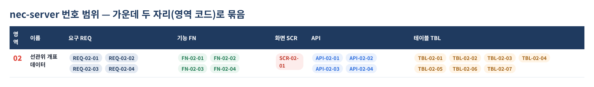
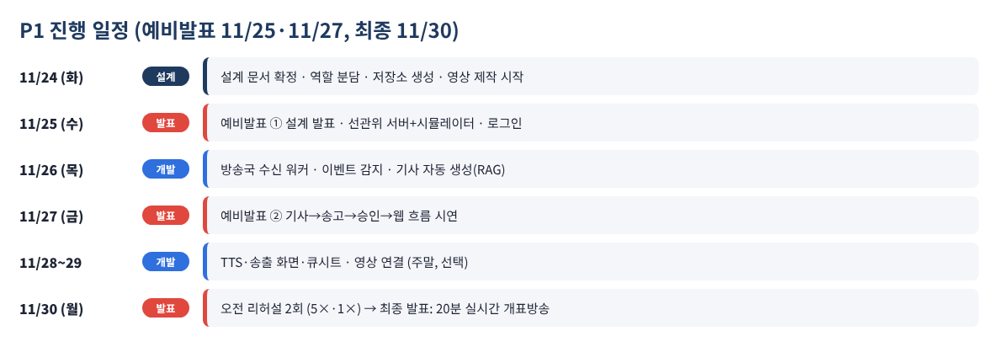
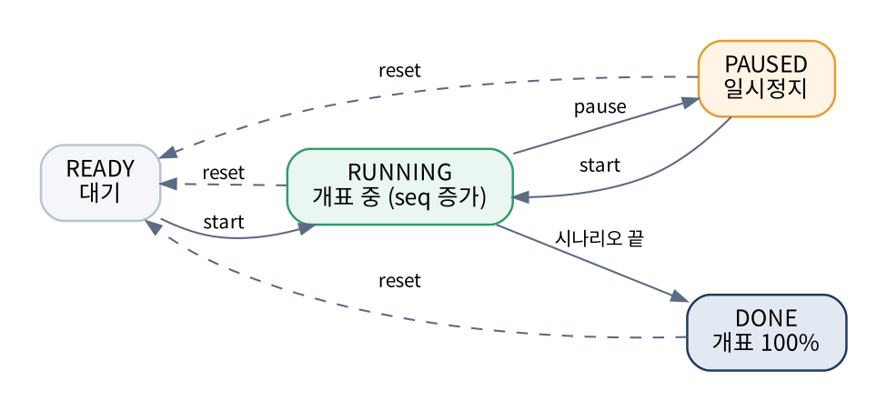
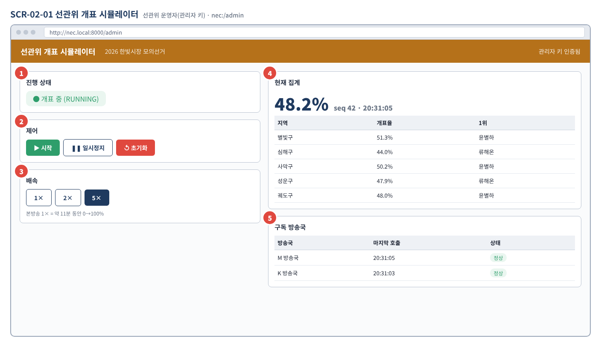
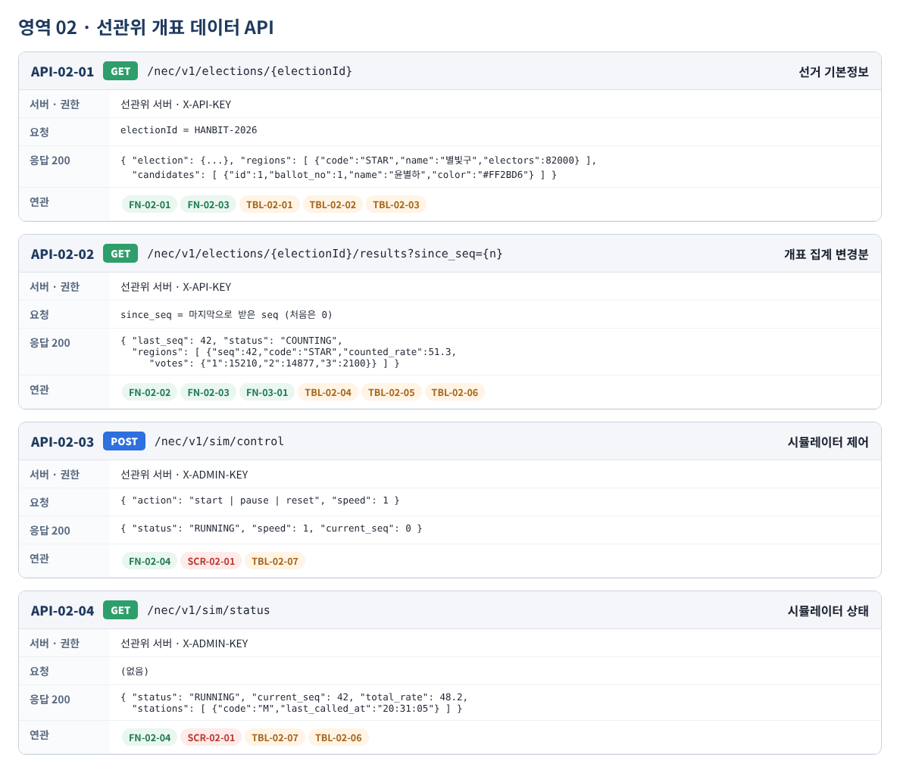
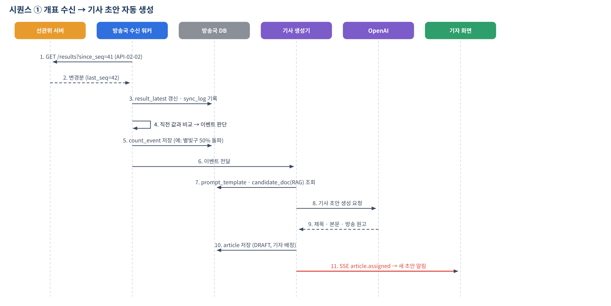

# 🗳️ nec-server — 선관위 서버

> AI 실시간 개표방송 시스템 · P1 팀 프로젝트

선거 원천 데이터(선거·지역·후보)와 개표 집계를 보관하고, 등록된 방송국(M·K)에게 API로 제공하는 서버입니다. 리허설과 본방송을 위해 개표 진행을 재현하는 시뮬레이터를 포함합니다.

<p align="center"></p>
<p align="center"><sub>전체 시스템에서 이 저장소의 위치</sub></p>

| 항목 | 내용 |
|---|---|
| 포트 | 8000 |
| 맡는 영역 | 02 선관위 개표 데이터 |
| 연결 저장소 | [station-onair](https://github.com/journal-izm/station-onair) |
| 전체 설계 | [election-onair](https://github.com/journal-izm/election-onair) |
| 설계 문서 폴더 | [Google Drive](https://drive.google.com/drive/folders/1Izs8LAkGqGRGMGK07rxIR9qtcB-rEDFs) |
| 규모 | 요구 7 · 기능 4 · 화면 1 · API 4 · 테이블 7 |

## 🤝 API 계약 (두 저장소를 잇는 약속)

| API | 경로 | 제공 | 호출 |
|---|---|---|---|
| API-02-01 | `GET /nec/v1/elections/{electionId}` | nec-server | station-onair (M·K) |
| API-02-02 | `GET /nec/v1/elections/{electionId}/results?since_seq={n}` | nec-server | station-onair (M·K) |

이 형식을 바꾸는 PR은 상대 저장소 담당자의 확인을 받습니다.

## 🚀 실행

```bash
python -m venv .venv && source .venv/bin/activate   # Windows: .venv\Scripts\activate
pip install -r requirements.txt
cp .env.example .env      # 값 채우기
python seed.py
uvicorn app.main:app --port 8000     # 관리 화면 :8000/admin · API 문서 :8000/docs
```

## 📌 번호 체계

가운데 두 자리(영역 코드)가 같으면 같은 기능 묶음입니다. 번호는 전체 설계(election-onair)와 같습니다.

<p align="center"></p>
<p align="center"><sub>이 저장소의 번호 범위</sub></p>

## 📚 설계 문서 8종

<details>
<summary><b>01 · 기획서 — 역할·범위·API 계약·일정</b></summary>

📄 원본: [Google Docs](https://docs.google.com/document/d/1L47u2tiqSNGEITmLd3QAB1aKOfRd63OPQA-Fu0Jb9do/edit) · [Word 파일](docs/01_기획서_nec-server.docx)

### 범위
| 포함 | 제외 (station-onair 담당) |
|---|---|
| 선거·지역·후보 기본정보 API | 기사 생성·송고·승인 |
| 개표 집계 변경분 API (since_seq) | 실시간 개표 웹·방송 화면 |
| 방송국 API 키 인증 | 기자·데스크 계정 |
| 개표 시뮬레이터 + 관리 화면 | TTS·영상·송출 |

### 개표 시나리오
가상 「2026 한빛시장 모의선거」 — 5개 구, 후보 3명.
- CSV 한 줄 = seq 하나의 지역·후보별 누적 득표
- 1배속에서 0→100%가 약 11분 (방송 LIVE 구간 길이)
- 당선 확정이 시작 후 약 10분 무렵 나오도록 설계
- 리허설 5배속, 본방송 1배속, 초기화로 반복 재현 (NFR-04)

### 일정
<p align="center"></p>
<p align="center"><sub>P1 일정</sub></p>


</details>

<details>
<summary><b>02 · 요구사항정의서 — 요구 7개와 추적표</b></summary>

📄 원본: [Google Docs](https://docs.google.com/document/d/1IX61rsmplFbQUfgAEYyJDZL9Tr1paCopO3T9aAOLil8/edit) · [Word 파일](docs/02_요구사항정의서_nec-server.docx)

### 영역 02 · 선관위 개표 데이터
| 요구 ID | 요구사항명 | 내용 | 우선순위 | 관련 기능 |
|---|---|---|---|---|
| REQ-02-01 | 선거 기본정보 제공 | 선관위 서버는 선거·지역(5개 구)·후보(3명) 기본정보를 API로 제공한다. | 필수 | FN-02-01 |
| REQ-02-02 | 개표 집계 변경분 제공 | 선관위 서버는 지역·후보별 득표와 개표율을 갱신하고, 순번(seq) 이후의 변경분만 내려준다. | 필수 | FN-02-02 |
| REQ-02-03 | 방송국 인증 | 선관위 API는 등록된 방송국(M·K)이 발급받은 API 키로만 호출할 수 있다. | 필수 | FN-02-03 |
| REQ-02-04 | 개표 시뮬레이터 | 리허설·방송을 위해 개표 진행을 시작·일시정지·배속·초기화할 수 있다. | 필수 | FN-02-04 |
| REQ-02-05 | 클라우드 시연 모드 | 클라우드 배포본은 서버가 켜질 때 초기 데이터를 넣고 개표 시나리오를 자동으로 반복 재생한다. | 권장 | FN-02-04 |

### 비기능 요구사항
| 요구 ID | 구분 | 요구사항명 | 내용 | 관련 기능 |
|---|---|---|---|---|
| NFR-02 | 보안 | 비밀 정보 보호 | 비밀번호는 해시로 저장, API 키·OpenAI 키는 .env에 두고 Git에 올리지 않는다. | FN-02-03 |
| NFR-04 | 운영 | 반복 리허설 | 시뮬레이터 초기화로 같은 개표 시나리오를 몇 번이고 다시 재현할 수 있다. | FN-02-04 |

### 추적표
| 요구 ID | 기능 | 화면 | API | 테이블 |
|---|---|---|---|---|
| REQ-02-01 | FN-02-01 | — | API-02-01 | TBL-02-01, TBL-02-02, TBL-02-03 |
| REQ-02-02 | FN-02-02 | — | API-02-02 | TBL-02-04, TBL-02-05 |
| REQ-02-03 | FN-02-03 | — | API-02-01, API-02-02 | TBL-02-06 |
| REQ-02-04 | FN-02-04 | SCR-02-01 | API-02-03, API-02-04 | TBL-02-04, TBL-02-05, TBL-02-07 |
| REQ-02-05 | FN-02-04 | SCR-02-01 | API-02-03, API-02-04 | TBL-02-04, TBL-02-05, TBL-02-07 |
| NFR-02 | FN-02-03 | — | API-02-01, API-02-02 | TBL-02-06 |
| NFR-04 | FN-02-04 | SCR-02-01 | API-02-03, API-02-04 | TBL-02-04, TBL-02-05, TBL-02-07 |


</details>

<details>
<summary><b>03 · 기능정의서 — 기능 4개·상태·업무 규칙</b></summary>

📄 원본: [Google Docs](https://docs.google.com/document/d/1mGIr3z_ha30krUNZQG2j4hIfDvFXanbYWvzuSS38dvc/edit) · [Word 파일](docs/03_기능정의서_nec-server.docx)

<p align="center"></p>
<p align="center"><sub>기능 구조도</sub></p>

### 영역 02 · 선관위 개표 데이터
| 기능 ID | 기능명 | 설명 | 요구 | 화면 | API | 테이블 |
|---|---|---|---|---|---|---|
| FN-02-01 | 선거 기본정보 제공 | 선거·지역·후보 정보를 방송국에 제공 | REQ-02-01 | — | API-02-01 | TBL-02-01 TBL-02-02 TBL-02-03 |
| FN-02-02 | 개표 집계 변경분 제공 | since_seq 이후 바뀐 지역·후보 집계만 응답 | REQ-02-02 | — | API-02-02 | TBL-02-04 TBL-02-05 |
| FN-02-03 | 방송국 API 키 인증 | X-API-KEY 헤더를 등록된 키와 대조 | REQ-02-03 NFR-02 | — | API-02-01 API-02-02 | TBL-02-06 |
| FN-02-04 | 개표 시뮬레이터 제어 | 시나리오에 따라 집계를 늘림. 시작·일시정지·배속·초기화. 시연 모드(DEMO_MODE)에서는 자동 시작·반복 | REQ-02-04 REQ-02-05 NFR-04 | SCR-02-01 | API-02-03 API-02-04 | TBL-02-07 TBL-02-04 TBL-02-05 |

### 시뮬레이터 상태
<p align="center"></p>
<p align="center"><sub>시뮬레이터 상태 전이</sub></p>

| 규칙 | 내용 |
|---|---|
| NBR-01 | 발행한 seq의 집계는 고치지 않는다 |
| NBR-02 | 득표는 누적값, 이전 seq보다 줄지 않는다 |
| NBR-03 | 비활성 방송국 키는 401 |
| NBR-04 | 호출 시 last_called_at 갱신 |
| NBR-05 | reset은 스냅숏 삭제 + seq 0 |


</details>

<details>
<summary><b>04 · 화면설계서 — 화면 1개</b></summary>

📄 원본: [Google Docs](https://docs.google.com/document/d/1aXYxPmPbQPW5DlfUGIPjQ_SLAV19PIywqqmhVYVHTSY/edit) · [Word 파일](docs/04_화면설계서_nec-server.docx)

| 화면 ID | 화면명 | 사용자 | URL |
|---|---|---|---|
| SCR-02-01 | 선관위 개표 시뮬레이터 | 선관위 운영자(관리자 키) | nec:/admin |

<details>
<summary><b>SCR-02-01 선관위 개표 시뮬레이터 <sub>(선관위 운영자(관리자 키))</sub></b></summary>

개표 진행을 재현하는 선관위 쪽 관리 화면. 계정이 아니라 관리자 키로 접근

- 관련 기능: FN-02-04
- 사용 API: API-02-03, API-02-04
- 사용 테이블: TBL-02-04, TBL-02-05, TBL-02-07

<p align="center"></p>
<p align="center"><sub>SCR-02-01 선관위 개표 시뮬레이터</sub></p>

| 번호 | 요소 | 설명 |
|---|---|---|
| 1 | 진행 상태 | 대기 / 개표 중 / 일시정지 / 종료 |
| 2 | 제어 버튼 | 시작·일시정지·초기화 |
| 3 | 배속 | 1×·2×·5× (리허설은 5×, 본방송은 1×) |
| 4 | 현재 seq·개표율 | 전체 개표율과 마지막 순번 |
| 5 | 구독 방송국 | M·K 방송국의 마지막 호출 시각 |


</details>


</details>

<details>
<summary><b>05 · DB설계서 — 테이블 7개</b></summary>

📄 원본: [Google Docs](https://docs.google.com/document/d/13dc3b-mvjBvF_wD-lN2gzxd-orJIHH1waHR83iQLrsQ/edit) · [Word 파일](docs/05_DB설계서_nec-server.docx)

<p align="center"></p>
<p align="center"><sub>nec_db ERD</sub></p>

| 테이블 ID | 테이블명 | 설명 | 사용 기능 |
|---|---|---|---|
| TBL-02-01 | `election` | 선거 기본정보 | FN-02-01 |
| TBL-02-02 | `region` | 개표 지역 (5개 구) | FN-02-01 |
| TBL-02-03 | `candidate` | 후보자 | FN-02-01 |
| TBL-02-04 | `count_region` | 지역별 개표 진행 스냅숏 (seq마다 1행) | FN-02-02 FN-02-04 |
| TBL-02-05 | `count_candidate` | 지역·후보별 득표 스냅숏 | FN-02-02 FN-02-04 |
| TBL-02-06 | `station_key` | 구독 방송국과 API 키 | FN-02-03 |
| TBL-02-07 | `sim_state` | 개표 시뮬레이터 상태 (1행) | FN-02-04 |

<details>
<summary><b>TBL-02-01 <code>election</code> — 선거 기본정보</b></summary>

| 컬럼 | 타입 | 키 | NULL | 설명 |
|---|---|---|---|---|
| `election_id` | VARCHAR(20) | PK | N | 예: HANBIT-2026 |
| `name` | VARCHAR(50) |  | N | 선거명 |
| `election_date` | DATE |  | N | 선거일 |
| `total_electors` | INTEGER |  | N | 전체 선거인 수 |
| `status` | VARCHAR(10) |  | N | READY / COUNTING / CLOSED |


</details>

<details>
<summary><b>TBL-02-02 <code>region</code> — 개표 지역 (5개 구)</b></summary>

| 컬럼 | 타입 | 키 | NULL | 설명 |
|---|---|---|---|---|
| `region_code` | VARCHAR(10) | PK | N | EAST / WEST … |
| `election_id` | VARCHAR(20) | FK | N | → election |
| `name` | VARCHAR(20) |  | N | 동구 등 |
| `electors` | INTEGER |  | N | 지역 선거인 수 |
| `sort_order` | INTEGER |  | N | 표시 순서 |


</details>

<details>
<summary><b>TBL-02-03 <code>candidate</code> — 후보자</b></summary>

| 컬럼 | 타입 | 키 | NULL | 설명 |
|---|---|---|---|---|
| `candidate_id` | INTEGER | PK | N | 후보 번호 |
| `election_id` | VARCHAR(20) | FK | N | → election |
| `ballot_no` | INTEGER |  | N | 기호 |
| `name` | VARCHAR(20) |  | N | 이름 |
| `party` | VARCHAR(30) |  | Y | 정당 |
| `color` | CHAR(7) |  | N | 차트 색 (#RRGGBB) |


</details>

<details>
<summary><b>TBL-02-04 <code>count_region</code> — 지역별 개표 진행 스냅숏 (seq마다 1행)</b></summary>

| 컬럼 | 타입 | 키 | NULL | 설명 |
|---|---|---|---|---|
| `seq` | INTEGER | PK | N | 갱신 순번 (전체 공통 증가) |
| `region_code` | VARCHAR(10) | PK,FK | N | → region |
| `counted_votes` | INTEGER |  | N | 개표된 투표수 |
| `invalid_votes` | INTEGER |  | N | 무효표 |
| `counted_rate` | DECIMAL(5,2) |  | N | 지역 개표율(%) |
| `created_at` | DATETIME |  | N | 집계 시각 |


</details>

<details>
<summary><b>TBL-02-05 <code>count_candidate</code> — 지역·후보별 득표 스냅숏</b></summary>

| 컬럼 | 타입 | 키 | NULL | 설명 |
|---|---|---|---|---|
| `seq` | INTEGER | PK,FK | N | → count_region.seq |
| `region_code` | VARCHAR(10) | PK,FK | N | → count_region |
| `candidate_id` | INTEGER | PK,FK | N | → candidate |
| `votes` | INTEGER |  | N | 누적 득표수 |


</details>

<details>
<summary><b>TBL-02-06 <code>station_key</code> — 구독 방송국과 API 키</b></summary>

| 컬럼 | 타입 | 키 | NULL | 설명 |
|---|---|---|---|---|
| `station_code` | VARCHAR(5) | PK | N | M / K |
| `station_name` | VARCHAR(30) |  | N | M 방송국 |
| `api_key_hash` | VARCHAR(100) |  | N | API 키 해시 |
| `last_called_at` | DATETIME |  | Y | 마지막 호출 시각 |
| `active` | BOOLEAN |  | N | 사용 여부 |


</details>

<details>
<summary><b>TBL-02-07 <code>sim_state</code> — 개표 시뮬레이터 상태 (1행)</b></summary>

| 컬럼 | 타입 | 키 | NULL | 설명 |
|---|---|---|---|---|
| `id` | INTEGER | PK | N | 항상 1 |
| `status` | VARCHAR(10) |  | N | READY / RUNNING / PAUSED / DONE |
| `speed` | INTEGER |  | N | 배속 1·2·5 |
| `current_seq` | INTEGER |  | N | 마지막 발행 seq |
| `scenario` | VARCHAR(30) |  | N | 시나리오 파일명 |
| `started_at` | DATETIME |  | Y | 시작 시각 |


</details>


</details>

<details>
<summary><b>06 · API명세서 — API 4개</b></summary>

📄 원본: [Google Docs](https://docs.google.com/document/d/1lOPbW845yIYp20XTynKOxwN-foT6Lbx6NxDKyrXjN2g/edit) · [Word 파일](docs/06_API명세서_nec-server.docx)

<p align="center"></p>
<p align="center"><sub>API 지도</sub></p>

| API ID | 메서드 | 경로 | 이름 | 권한 |
|---|---|---|---|---|
| API-02-01 | GET | `/nec/v1/elections/{electionId}` | 선거 기본정보 | X-API-KEY |
| API-02-02 | GET | `/nec/v1/elections/{electionId}/results?since_seq={n}` | 개표 집계 변경분 | X-API-KEY |
| API-02-03 | POST | `/nec/v1/sim/control` | 시뮬레이터 제어 | X-ADMIN-KEY |
| API-02-04 | GET | `/nec/v1/sim/status` | 시뮬레이터 상태 | X-ADMIN-KEY |

<details>
<summary><b>영역 02 · 선관위 개표 데이터 API</b></summary>

<p align="center"></p>
<p align="center"><sub>영역 02 API</sub></p>

#### API-02-01 `GET /nec/v1/elections/{electionId}` — 선거 기본정보
권한: X-API-KEY · 테이블 TBL-02-01, TBL-02-02, TBL-02-03

요청
```json
electionId = HANBIT-2026
```
응답 200
```json
{ "election": {...}, "regions": [ {"code":"EAST","name":"동구","electors":82000} ],
  "candidates": [ {"id":1,"ballot_no":1,"name":"김하늘","color":"#2F6FDE"} ] }
```
#### API-02-02 `GET /nec/v1/elections/{electionId}/results?since_seq={n}` — 개표 집계 변경분
권한: X-API-KEY · 테이블 TBL-02-04, TBL-02-05, TBL-02-06

요청
```json
since_seq = 마지막으로 받은 seq (처음은 0)
```
응답 200
```json
{ "last_seq": 42, "status": "COUNTING",
  "regions": [ {"seq":42,"code":"EAST","counted_rate":51.3,
     "votes": {"1":15210,"2":14877,"3":2100}} ] }
```
#### API-02-03 `POST /nec/v1/sim/control` — 시뮬레이터 제어
권한: X-ADMIN-KEY · 테이블 TBL-02-07

요청
```json
{ "action": "start | pause | reset", "speed": 1 }
```
응답 200
```json
{ "status": "RUNNING", "speed": 1, "current_seq": 0 }
```
#### API-02-04 `GET /nec/v1/sim/status` — 시뮬레이터 상태
권한: X-ADMIN-KEY · 테이블 TBL-02-07, TBL-02-06

요청
```json
(없음)
```
응답 200
```json
{ "status": "RUNNING", "current_seq": 42, "total_rate": 48.2,
  "stations": [ {"code":"M","last_called_at":"20:31:05"} ] }
```

</details>


</details>

<details>
<summary><b>07 · 시스템설계도 — 구성·흐름·실행 설정</b></summary>

📄 원본: [Google Docs](https://docs.google.com/document/d/1h2wjscgBeKQW_OOFiI-NrqKBK93EyjK0XZVPoJEzqMI/edit) · [Word 파일](docs/07_시스템설계도_nec-server.docx)

<p align="center"></p>
<p align="center"><sub>저장소 관계</sub></p>

| 구성 요소 | 역할 |
|---|---|
| NEC API 서버 | 기본정보·변경분 제공, 키 확인 |
| 개표 시뮬레이터 | 시나리오 CSV를 배속에 맞춰 seq 단위로 기록 |
| 관리 화면 | 시작·일시정지·배속·초기화 |
| nec_db | TBL-02-01~07 |

<p align="center"></p>
<p align="center"><sub>방송국 수신 흐름 (1~2번이 nec-server 구간)</sub></p>

| 변수 | 예 |
|---|---|
| NEC_DB_URL | sqlite:///nec.db |
| ADMIN_KEY | (비밀) |
| SCENARIO | hanbit_2026.csv |


</details>

<details>
<summary><b>08 · 개발환경검토서 — 기술·폴더 구조·규칙</b></summary>

📄 원본: [Google Docs](https://docs.google.com/document/d/1BtGm1r2c_t8xJaFws59fIQ013U0XwjA6YxHwXacmKZs/edit) · [Word 파일](docs/08_개발환경검토서_nec-server.docx)

<p align="center"></p>
<p align="center"><sub>폴더 구조</sub></p>

### 결정 사항 (11/24)
| 항목 | 결정 |
|---|---|
| DB | SQLite |
| 실행 장소 | 강의장 LAN(본방송) + 클라우드(시연, DEMO_MODE) |

### 협업 규칙 (PR 리뷰 생략)
| 규칙 | 내용 |
|---|---|
| 담당 파일 | 영역 번호대로 파일을 맡는다. 남의 파일을 고쳐야 하면 Slack에 먼저 알린다 |
| 브랜치 | `main`(발표용) ← `dev`(합치는 곳) ← `feature/영역코드-이름` (예: `feature/04-article-gen`) |
| 합치기 | 팀원 리뷰 없이 **본인이 `dev`에 합친다**. 기록이 남도록 PR로 합친다 |
| 합치기 전 확인 | ① 내 PC에서 서버가 켜지는지 ② `.env`·`*.db`가 올라가지 않는지 ③ 커밋·PR 제목에 번호 (예: `FN-05-02 승인 API`) |
| `main` | 리허설·발표 전에만 강사가 `dev`를 `main`에 합친다 |
| API 계약 변경 | 선관위 API(API-02-01·02-02) 형식을 바꾸기 전에 상대 저장소 담당자에게 Slack으로 알린다 |

</details>

